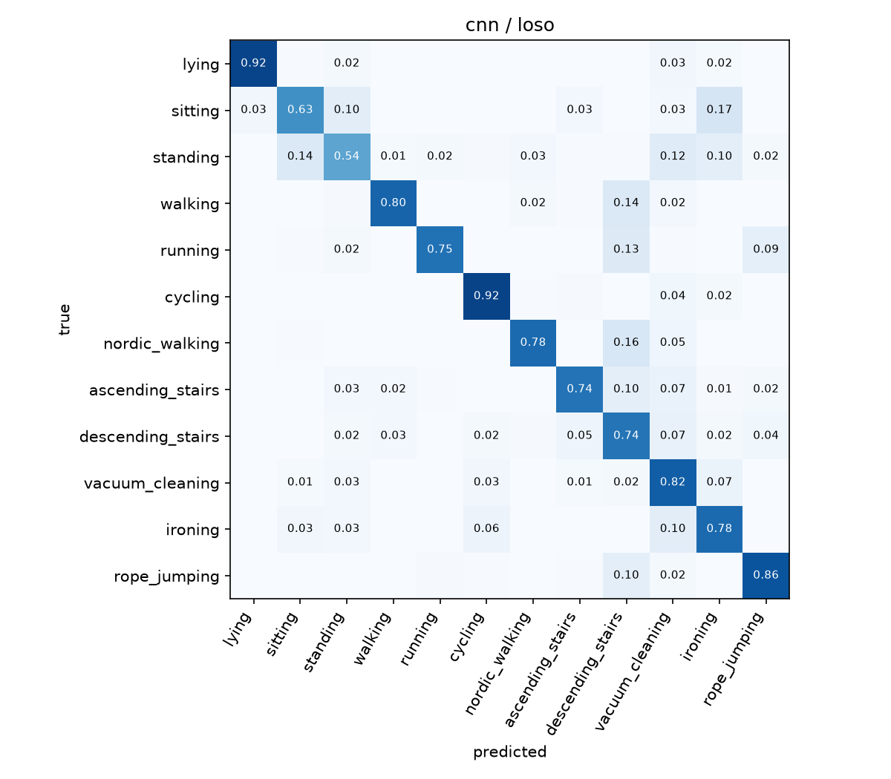
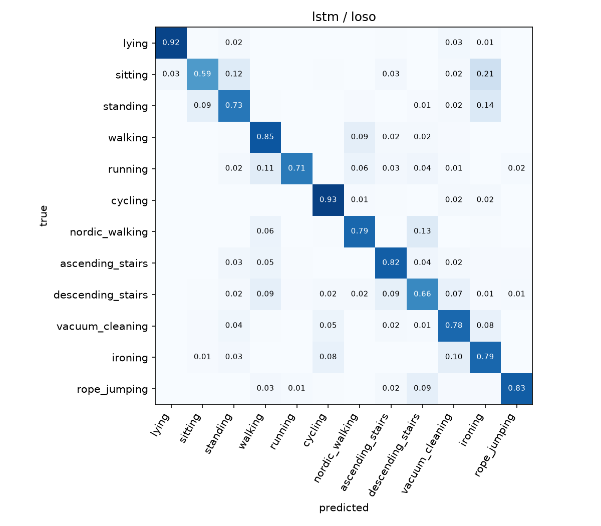
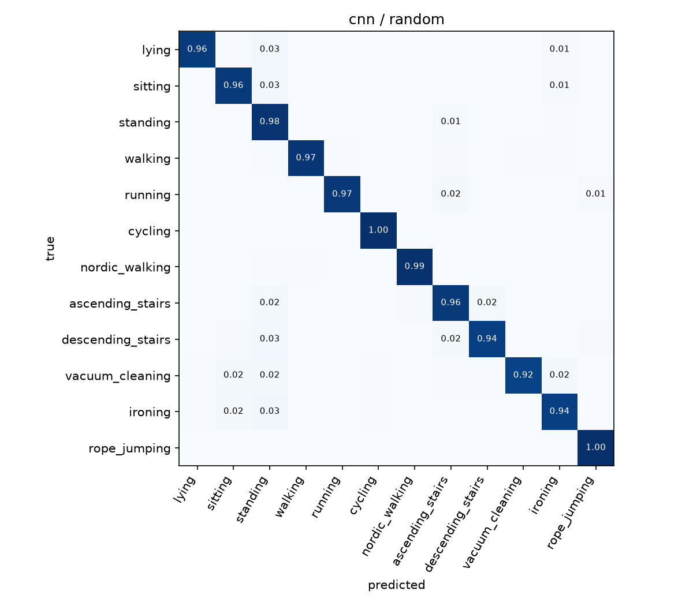

# pamap2-har

PAMAP2(身体3か所のIMU+心拍計)の生データから、12種類の身体活動を分類する PyTorch 実装です。
1D-CNN と CNN+双方向LSTM の2つのモデルを、**被験者単位の交差検証(leave-one-subject-out, LOSO)** で評価します。

## この実装で重視したこと

**評価を、実際の使われ方に合わせること。** 活動認識のモデルは、学習に使っていない人に対して使われます。
窓をランダムに分けると、同じ人の、しかも半分重なった隣の窓が学習側と評価側の両方に入り、精度が高く出ます。
このリポジトリでは被験者単位で分け、比較用にランダム分割の結果も並べて、その差を示しています。

ほかに、次の点を自分で決めて実装しています。

| 項目 | 方針 |
|---|---|
| 心拍(約9Hz)とIMU(100Hz)の周波数の違い | 被験者ごとに線形補間して100Hzにそろえる |
| IMUの欠損(無線の取りこぼし) | 線形補間。補間しきれない先頭・末尾の行は捨てる |
| 使うチャネル | 各IMUの加速度(±16g)とジャイロ、計18ch+心拍1ch。±6gの加速度は高加速度で飽和するため、姿勢は付属説明で無効とされているため使わない |
| 窓 | 2秒(200サンプル)、1秒ずらし。同じ活動が続く区間の中だけで切り、ラベルの混ざった窓は作らない |
| 正規化 | チャネルごとの平均・標準偏差を、学習側のデータだけで求める |
| 早期終了 | テスト被験者とは別の被験者1人を検証用にし、その macro-F1 で判断する(テスト側を見ない) |
| クラス不均衡 | 出現頻度の逆数で損失に重み付け |
| 指標 | 正解率と macro-F1。テスト被験者が行っていない活動は macro-F1 の平均に入れない |

## 結果

PAMAP2 の被験者 101〜108(8人)、12活動、窓2秒・ずらし1秒、心拍あり。乱数シードは0で、各設定1回の実行です。

| モデル | 分割 | 正解率 | macro-F1 |
|---|---|---|---|
| 1D-CNN | 被験者単位(LOSO, 8人) | 0.778 ± 0.135 | 0.749 ± 0.145 |
| CNN+BiLSTM | 被験者単位(LOSO, 8人) | 0.794 ± 0.112 | 0.761 ± 0.130 |
| 1D-CNN | ランダム(80/10/10) | 0.964 | 0.965 |

LOSO の値は、8人それぞれをテストにした8回の平均 ± 標準偏差です。

### 読み取れること

- **分割の仕方だけで、正解率が約0.19、macro-F1 が約0.22 変わります。** 同じ 1D-CNN でも、ランダム分割では 0.964、被験者単位では 0.778 でした。ランダム分割では、同じ人の、しかも半分重なった隣の窓が学習側と評価側の両方に入るため、未知の人に対する性能より高く出ます。
- **人によるばらつきが大きいです。** 1D-CNN の正解率は、被験者107で 0.932、被験者108で 0.498 でした。CNN+BiLSTM でも、被験者108が最も低い値でした(0.557)。被験者108で低い理由は、まだ分析していません。
- **静止した活動どうしの取り違えが多いです。** 被験者単位では、座る・立つ・アイロンがけの間の取り違えが目立ちます(1D-CNN で、座るの17%がアイロンがけ、立つの14%が座ると判定)。体の動きが小さい活動は、センサーの信号が似るためと考えられます。

### 混同行列

| 1D-CNN / 被験者単位 | CNN+BiLSTM / 被験者単位 | 1D-CNN / ランダム |
|---|---|---|
|  |  |  |

## 使い方

### 1. 環境

Python 3.10 以上。GPU(CUDA)がある場合は、先に CUDA 版の PyTorch を入れてから、残りのライブラリを入れます。

```
pip install torch --index-url https://download.pytorch.org/whl/cu126
pip install -r requirements.txt
```

CUDA のバージョンに合わせたコマンドは、[PyTorch の公式ページ](https://pytorch.org/get-started/locally/) で確認できます。GPU がない場合は `pip install -r requirements.txt` だけで動きます(学習は遅くなります)。

### 2. データ

[UCI Machine Learning Repository の PAMAP2](https://archive.ics.uci.edu/dataset/231/pamap2+physical+activity+monitoring) からダウンロードし、展開して `data/` に置きます。

```
data/PAMAP2_Dataset/Protocol/subject101.dat ... subject109.dat
```

subject109 はプロトコル活動のデータが少ないため、既定では使いません(`--subjects 101 ... 109` で含められます)。

### 3. 実行

```
python -m src.train --data-dir data/PAMAP2_Dataset/Protocol --model cnn  --split loso
python -m src.train --data-dir data/PAMAP2_Dataset/Protocol --model lstm --split loso
python -m src.train --data-dir data/PAMAP2_Dataset/Protocol --model cnn  --split random
```

結果は `results/` に JSON(被験者ごとの値と平均・標準偏差)と混同行列の画像で保存されます。
主なオプション: `--window`, `--stride`, `--no-hr`(心拍を使わない), `--epochs`, `--patience`, `--verbose`

### 実データなしで動作を確認する

PAMAP2 と同じ形式の合成データを作って、パイプラインを通せます(信号に物理的な意味はありません)。

```
python scripts/make_synthetic.py --out data/synthetic
python -m src.train --data-dir data/synthetic --model cnn --split loso --epochs 5
```

## 構成

```
src/data.py                読み込み・補間・窓切り・正規化
src/models.py              1D-CNN、CNN+双方向LSTM
src/train.py               学習・評価(LOSO / ランダム分割)・結果の保存
scripts/make_synthetic.py  動作確認用の合成データ
results/                   実データでの結果(JSONと混同行列)
```

## データの出典

A. Reiss and D. Stricker. Introducing a New Benchmarked Dataset for Activity Monitoring. The 16th IEEE International Symposium on Wearable Computers (ISWC), 2012.

データセットは UCI Machine Learning Repository で CC BY 4.0 ライセンスのもと公開されています(DOI: [10.24432/C5NW2H](https://doi.org/10.24432/C5NW2H))。

## ライセンス

コードは MIT License です。詳しくは [LICENSE](LICENSE) を参照してください。
